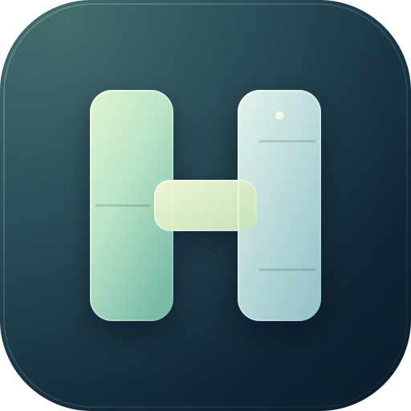
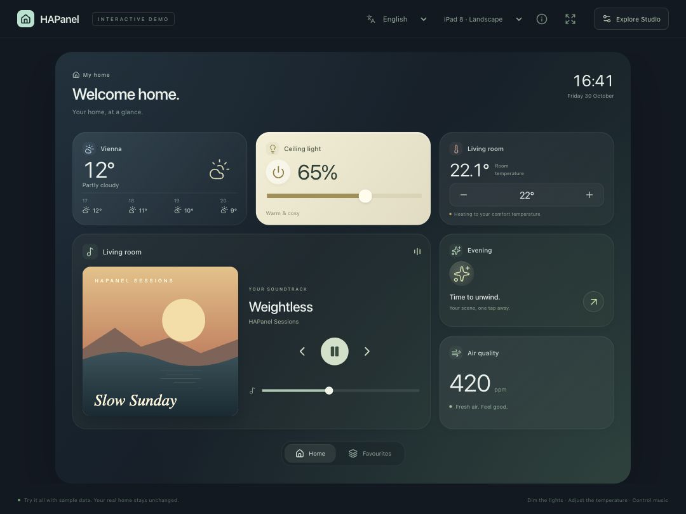
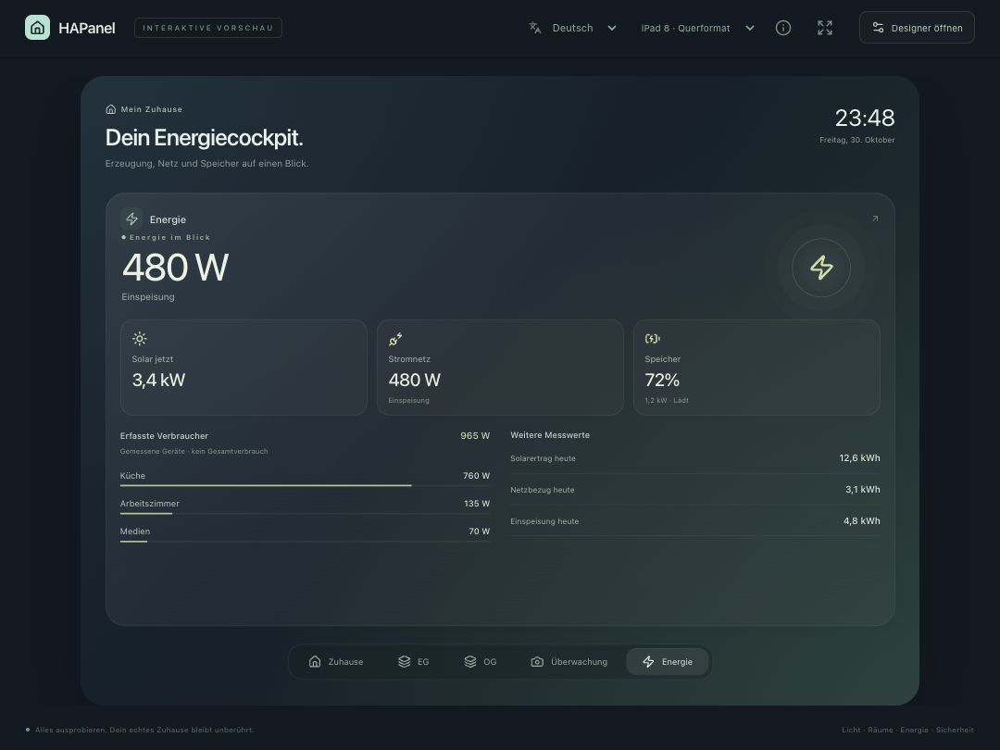
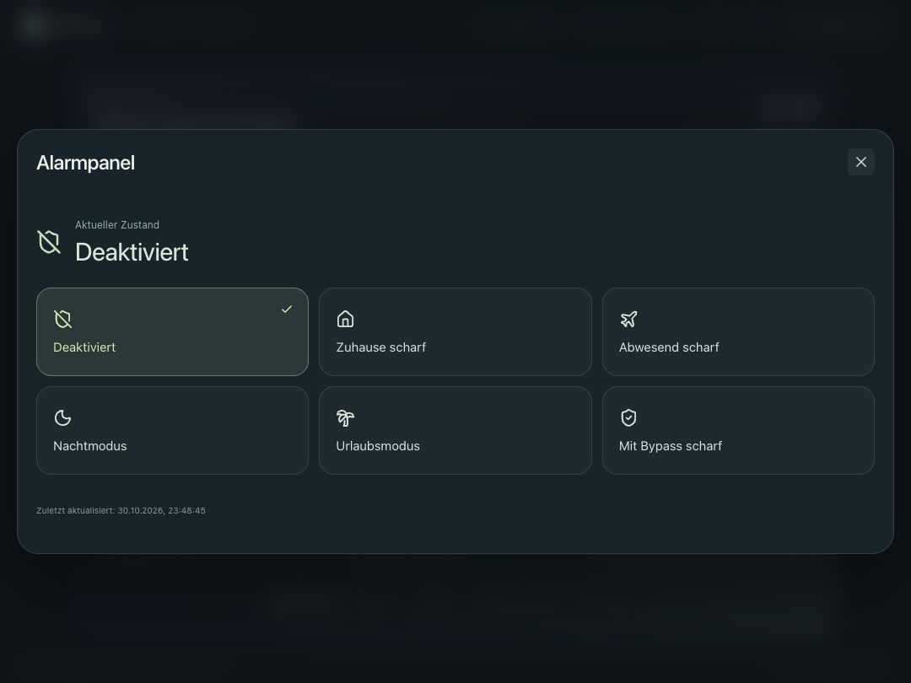
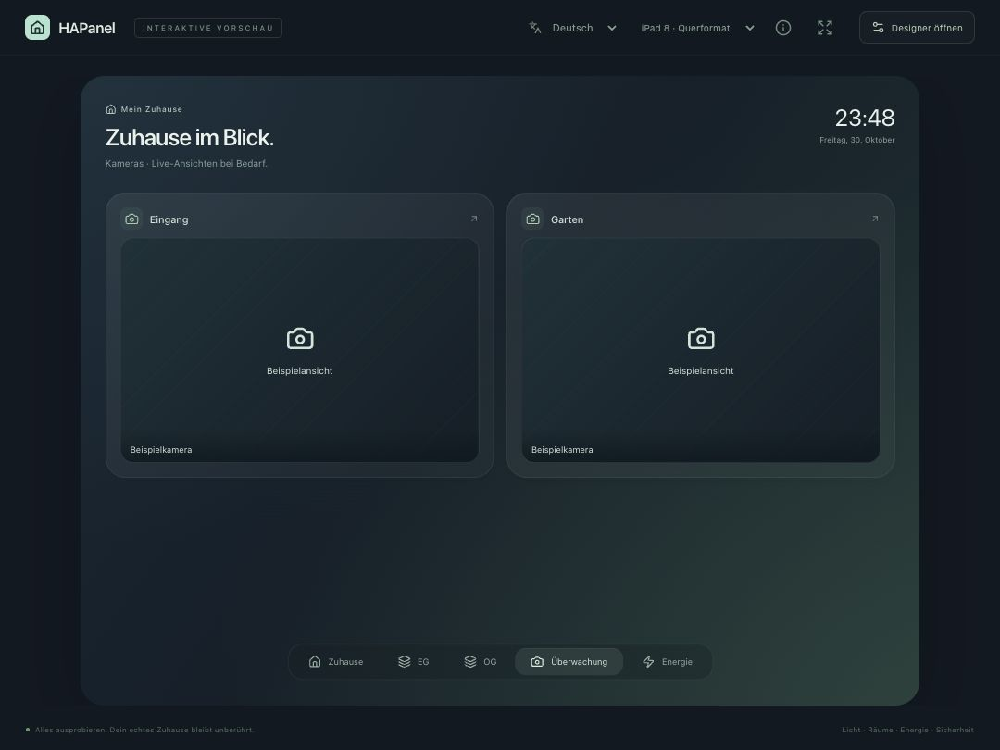
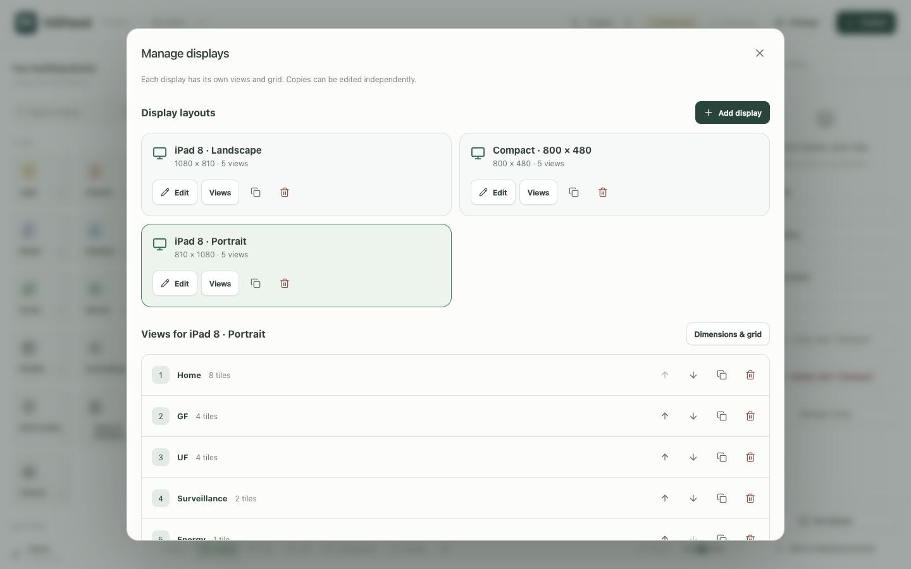
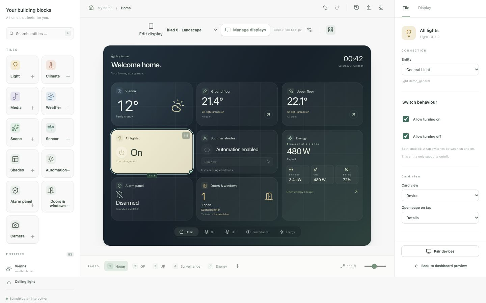
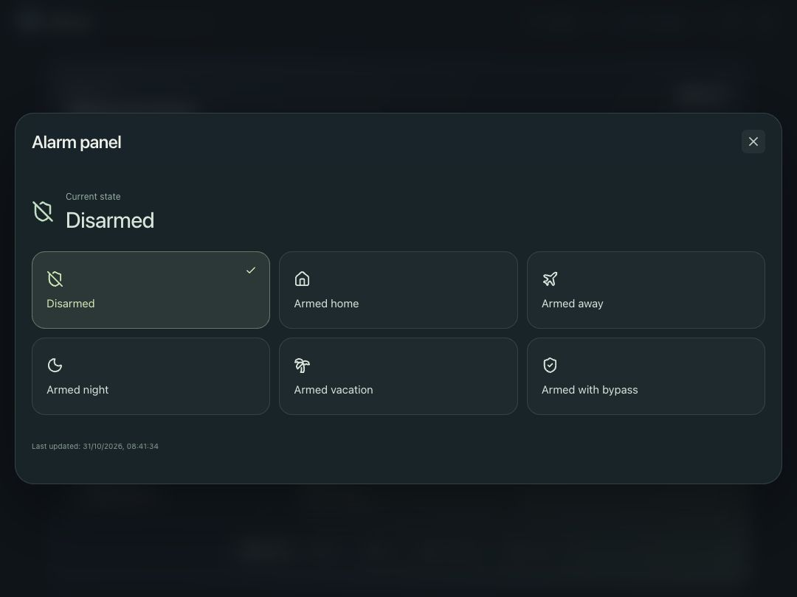

<p align="center"></p>
<h1 align="center">HAPanel</h1>
<p align="center">Your home, at a glance.</p>
<p align="center">An independent Home Assistant dashboard and visual editor for wall tablets and browser-based touch displays.</p>
<p align="center"><a href="https://cococheaf.github.io/HAPanel/">Interactive iPad preview</a> · <a href="DOCS.en.md">Installation</a> · <a href="docs/translations.md">Translations</a> · <a href="CONTRIBUTING.en.md">Contributing</a></p>

**[Deutsch](README.md) · English**

**A vibe-coded project:** HAPanel is built with AI assistance. Its creator contributes the idea, design and hands-on testing and has no programming background. Code reviews, clear bug reports and community contributions are very welcome.



<details><summary>Energy cockpit</summary>



</details>

HAPanel combines rounded tiles, calm colours and direct touch controls with a visual layout editor. It runs as a Home Assistant app (add-on) or a local Node.js process. Existing Lovelace dashboards and HA configuration files are preserved.

**Version: 1.5.0.** The preview, editor and API are implemented. The HA adapter is tested against a simulated WebSocket server. Installation, updates, Ingress and live data are verified on HA OS 18.4 / Core 2026.10.4 (amd64). Testing on physical iPad hardware remains pending.

## Try it

Open the [preview](https://cococheaf.github.io/HAPanel/) in Safari on your iPad. Room details, lights, dimming, temperature, shades, weather and the energy cockpit use interactive sample data. Choose **Open Designer** to edit the layout. Changes stay in your browser; **Publish** applies your draft to the preview dashboard.

For a standalone view, choose **Share → Add to Home Screen**. Landscape, portrait and compact profiles are included. The public preview has no access to a real Home Assistant instance or credentials. Media controls simulate states and do not play audio.

## Included

- **German and English from the start**, with automatic browser-language detection, a manual language selector, localised dates/numbers and translatable errors.
- Light groups, automations, inline alarm controls with configurable modes and filtered door/window summaries.
- Camera tiles with snapshots, optional live overview, WebRTC and HLS video, plus an image-sequence fallback for cameras without streaming.
- Floor navigation and room cards with individual device detail views.
- Lights, climate, shades, media with album art, hourly weather, scenes and sensors.
- Energy cockpit for solar, grid, battery and monitored loads, plus 24-hour meter history.
- Drag-and-drop editor, resize handles, numeric positioning and undo/redo.
- Multiple pages and display profiles, including iPad 8 in both orientations and 800 × 480.
- Separate physical resolution and browser viewport, configurable grid, margins and spacing.
- Exact CSS-pixel rendering or proportional fitting, using the same tiles in editor and player.
- Autosaved drafts, explicit publication and up to 30 previous revisions.
- JSON/YAML import and export.
- Server-side HA WebSocket connection with filtered subscriptions and reconnection.
- Administrator-only Designer, optional camera viewing for active HA users, and a paired display endpoint with revocable device sessions.
- Dockerfile and GitHub Actions for validation, the hosted preview and amd64/aarch64 builds.

UI language is stored per browser, independently of HA settings and saved layouts. Untouched sample labels are localised for the preview. Your own titles, greetings and HA entity names remain as entered. [Adding more languages](docs/translations.md) requires a translation catalog and registry entry.

## Develop locally

Node.js 24 LTS is recommended; minimum version 22.12.

```sh
npm ci
npm run dev
```

- Studio: <http://127.0.0.1:5173/>
- Standalone browser preview: <http://127.0.0.1:5173/preview.html>
- API: <http://127.0.0.1:4310/api/health>

The default mode uses sample data only. Server-side layouts are stored in the ignored `.data/` directory. The standalone browser preview stores its layouts in the browser instead.

```sh
npm test
npm run build
npm run build:preview
npm start
```

After the production build, `npm start` serves Studio and the player on port 4310. See the [installation guide](DOCS.en.md) for add-on deployment, standalone HA access, pairing and HTTPS reverse proxies.

## Isolation and access

HAPanel needs no HA configuration mount, custom cards, extra integration or hardware permissions. It stores data in its own private app directory. Normal device actions update the shared HA device state.

The Supervisor token stays in the backend and is treated as an administrator credential. Displays submit tile IDs and allowed control commands; the backend derives HA services and entity targets from the published configuration. Pairing codes are valid for five minutes and can be used once. Device sessions expire after 90 days and can be revoked. Use HTTPS and the correct `public_origin` for live displays.

## Development status

Physical iPad and long-term acceptance, automatic viewport calibration, additional device capabilities and adaptive reflow are the next milestones. German and English are implemented; more languages can follow through the shared catalogs. Unknown stored schema versions are explicitly rejected and their files are preserved. Shared layouts are migrated to independent display views with a backup of the original file.

## Credits and licence

The tile concept and visual workflow are inspired by [Tessera](https://github.com/MaxGramser/homeassistant_espscreen). HAPanel is an independent implementation and incorporates no Tessera source code, firmware or assets. It contains no ESPHome, flashing, USB or microcontroller logic.

HAPanel is [MIT licensed](LICENSE). Icons are from [Lucide](https://lucide.dev/license). The sample album artwork and project mark are original SVG graphics. No external fonts, analytics scripts or image services are used. HAPanel is independent of Apple and the Home Assistant project.

<details><summary>Inline alarm controls · Surveillance</summary>





</details>

## Displays and cameras

At the top of the Designer, **Edit display** selects the layout you are working on. **Manage displays** provides creation, duplication and removal. Views can be reordered, deleted with their tiles or copied to another or a new display. Copies are independent. Colours and greetings belong to the selected display. **Manage devices** handles paired browser access separately.

In a camera tile, choose **Snapshot** or **Live stream** under **Camera overview**. **Automatic** prefers the WebRTC connection offered by HA and falls back to HLS when needed. WebRTC requires a reachable direct media connection in your network; HLS can still introduce delay. **Jump to live edge** is available in HLS details.



## Light controls that match your devices

Select a light tile in the Designer → **Switch behaviour**. **Allow turning on** and **Allow turning off** configure its power button:

| Turn on | Turn off | Behaviour          |
| ------- | -------- | ------------------ |
| ✓       | ✓        | Toggle on and off  |
| ✓       | —        | Turn on only       |
| —       | ✓        | Turn off only      |
| —       | —        | Display state only |

This also applies to switch entities and devices inside room cards. The backend enforces the options. These are rules for the individual HAPanel control; other HA interfaces and automations operate independently.

Dimmer sliders require confirmed dimming support. **Every** group member must be dimmable; ordinary on/off lights, switches, mixed groups and groups with unknown members receive no slider. Missing brightness values on active lights remain unknown. One-way controls hide the slider to prevent it from triggering a disabled action. Eligible dimmable controls also offer **Show dimmer slider** to hide it manually.

Page names, headings and custom labels preserve spaces while typing and saving. Required fields can be cleared temporarily while renaming; leaving an empty required field restores its last valid text.



## Cameras without an administrator role

In **Settings → Apps → HAPanel → Configuration → Camera viewing**, select `authenticated`, save and restart. The default `admin` retains the existing access policy.

With `authenticated`, **active, signed-in HA users** can view the published HAPanel dashboard including cameras in **View only** mode. **Valid paired tablets** also receive camera images while retaining their previous device controls. Designer, drafts and pairing management remain administrator-only. Alarm commands can be shared separately through `alarm_access`. Camera access always requires HA sign-in or a valid pairing.

Sharing covers all cameras bound in the published HAPanel configuration, not arbitrary HA entities. This is an explicit HAPanel sharing policy; individual HA entity permissions are not replicated.

## Alarm controls without an administrator role

In **Settings → Apps → HAPanel → Configuration → Alarm controls**, choose `authenticated`, save and restart. Active HA users and valid paired tablets may then use the published alarm modes directly in HAPanel. Camera viewing and alarm controls are shared independently; both default to `admin`.

The HA alarm entity determines whether a PIN is required. HAPanel retains that requirement and confirmation of the selected mode. Repeated attempts are limited and alarm codes are not stored. Designer and device management remain protected. Ordinary HA viewers cannot perform other device actions; paired tablets retain their existing controls.


