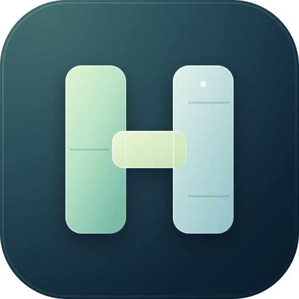
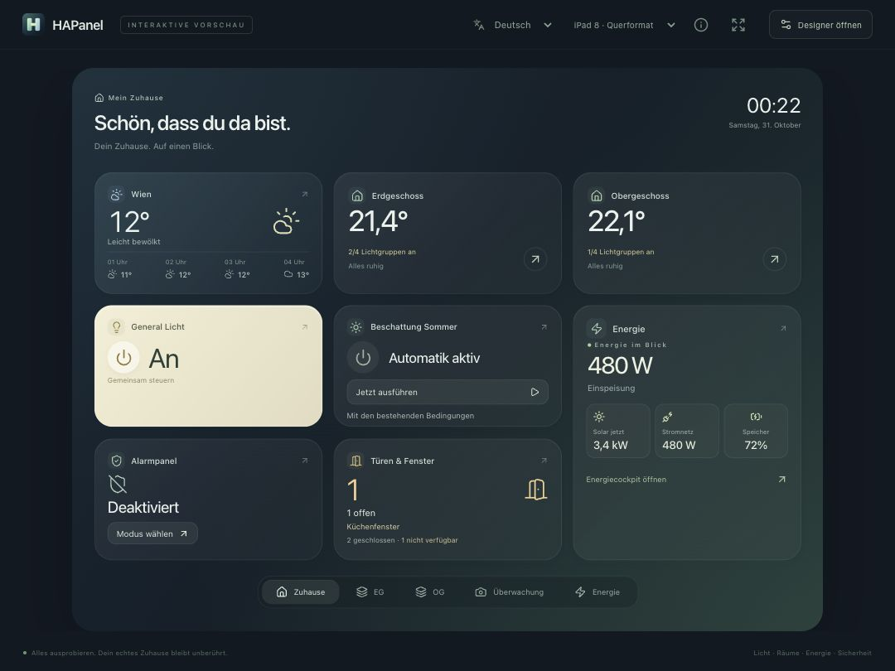
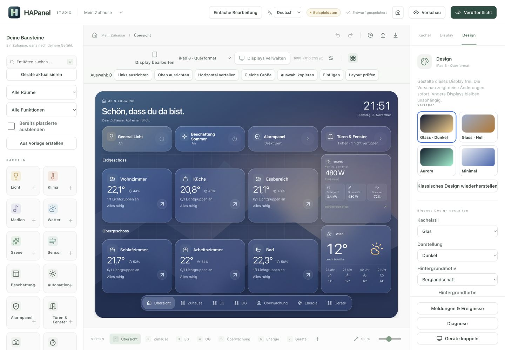

<p align="center"></p>
<h1 align="center">HAPanel</h1>
<p align="center">Dein Zuhause. Auf einen Blick.</p>
<p align="center">Ein eigenständiges Home Assistant Dashboard mit visuellem Editor – für dein Wandtablet und browserfähige Touchdisplays.</p>
<p align="center"><a href="https://cococheaf.github.io/HAPanel/">Interaktive iPad-Demo</a> · <a href="DOCS.md">Installation</a> · <a href="docs/architecture.md">Architektur</a> · <a href="CONTRIBUTING.md">Mitmachen</a></p>

**Deutsch · [English](README.en.md)**



<details><summary>Visuellen Editor ansehen</summary>



</details>

HAPanel verbindet großzügige, abgerundete Kacheln, ruhige Farben und direkte Touch-Bedienung mit einem visuellen Layout-Editor. Es läuft als eigene Home Assistant App (Add-on) oder als lokaler Node.js-Prozess. Bestehende Lovelace-Dashboards und HA-Konfigurationsdateien bleiben unverändert.

**Status: 0.1.0-alpha.2 – erste funktionsfähige Vorschau.** Die Demo, der Editor und die API sind implementiert. Die HA-Anbindung ist gegen einen simulierten WebSocket-Server geprüft. Ein echter Supervisor-Installationslauf und Tests auf physischer iPad-Hardware sind noch ausstehend.

## Ausprobieren

Öffne die [Demo](https://cococheaf.github.io/HAPanel/) in Safari auf dem iPad. Licht, Dimmer, Temperatur, Mediensteuerung und Szene sind mit Beispieldaten bedienbar. Über **Studio erkunden** kannst du das Layout bearbeiten. Änderungen bleiben in deinem Browser; **Veröffentlichen** übernimmt den Entwurf in die Demo-Ansicht.

Für eine eigenständige Ansicht: **Teilen → Zum Home-Bildschirm**. Wähle bei Bedarf das Querformat- oder Hochformatprofil. Die öffentliche Demo hat keine Verbindung zu einem echten Home Assistant und enthält keine Zugangsdaten. Mediensteuerung simuliert Zustände; die Demo spielt kein Audio ab.

## Bereits enthalten

- Licht, Klima, Medien mit Album-Art, Wetter mit Stundenprognose, Szenen und Sensoren.
- Deutsche und englische Oberfläche mit automatischer Browser-Spracherkennung und manueller Sprachwahl; weitere Sprachen sind über zentrale Übersetzungsdateien ergänzbar.
- Visueller Editor mit Verschieben, Größenänderung, numerischen Positionen und Undo/Redo.
- Mehrere Seiten und Displayprofile; Beispielprofile für iPad 8 in beiden Ausrichtungen und 800 × 480.
- Getrennte Hardwareauflösung und Browserfläche, einstellbares Raster, Außenränder und Abstände.
- Exakte Darstellung oder proportionales Einpassen; identische Kacheln in Editor und Player.
- Automatisch gespeicherte Entwürfe, explizite Veröffentlichung und bis zu 30 ältere Revisionen.
- JSON/YAML-Import und Export.
- Serververbindung zu HA mit gefilterten Entitätsabonnements, Wiederverbindung und serverseitigen Aktionen.
- Ingress-Zugang für HA-Administratoren und separater, optionaler Display-Port mit widerrufbarer Kopplung.
- Dockerfile und GitHub Actions für Validierung, statische Demo und Container-Builds auf amd64/aarch64.

## Lokal entwickeln

Node.js 24 LTS empfohlen; Mindestversion 22.12.

```sh
npm ci
npm run dev
```

- Studio: <http://127.0.0.1:5173/>
- Eigenständige Browserdemo: <http://127.0.0.1:5173/demo.html>
- API: <http://127.0.0.1:4310/api/health>

Der Standardmodus verwendet ausschließlich Beispieldaten. Serverseitige Layouts liegen im ignorierten Verzeichnis `.data/`. Die eigenständige Browserdemo speichert ihre Layouts dagegen im Browser.

```sh
npm test
npm run build
npm run build:demo
npm start
```

Nach dem Produktionsbuild liefert `npm start` Studio und Player über Port 4310 aus. Die weiteren Betriebsarten, Kopplung und Reverse-Proxy-Einstellungen stehen in [DOCS.md](DOCS.md).

## Isolation und Zugriff

HAPanel benötigt keinen Mount der HA-Konfiguration, keine Custom Cards, keine zusätzliche HA-Integration und keine Hardwarefreigaben. Eigene Daten liegen im privaten Add-on-Speicher. Reguläre Bedienaktionen verändern selbstverständlich den gemeinsamen HA-Gerätezustand.

Das Supervisor-Token bleibt im Backend und wird als Administratorzugang behandelt. Displays übergeben Kachel-IDs und erlaubte Bedienbefehle; HA-Services und Zielentitäten werden vom Server aus der veröffentlichten Konfiguration bestimmt. Kopplungscodes sind fünf Minuten gültig und einmal verwendbar; Gerätesitzungen sind widerrufbar und laufen nach 90 Tagen ab. Für den echten Displaybetrieb ist ein HTTPS-Endpunkt mit korrekt gesetztem `public_origin` vorgesehen.

## Nächste Schritte

Die [Roadmap](docs/roadmap.md) benennt die noch offenen Arbeiten: echte HA-/iPad-Abnahme, automatische Viewport-Kalibrierung, weitere Gerätefähigkeiten und vollständig adaptive Layouts. Deutsch und Englisch sind von Anfang an unterstützt; [weitere Sprachen](docs/translations.md) können folgen. Ältere gespeicherte Schemaversionen werden derzeit ausdrücklich abgelehnt und nicht verändert; Migrationen folgen bei der ersten Schemaänderung.

## Herkunft und Lizenz

Die Kachelidee und der visuelle Arbeitsablauf sind von [Tessera](https://github.com/MaxGramser/homeassistant_espscreen) inspiriert. HAPanel ist eine eigenständige Implementierung; Tessera-Code, Firmware und Assets wurden nicht übernommen. HAPanel enthält keine ESPHome-, Flashing-, USB- oder Mikrocontroller-Logik.

HAPanel: [MIT](LICENSE). Icons: [Lucide](https://lucide.dev/license). Beispiel-Albumcover und Projektlogo sind eigene SVG-Grafiken. Die gesamte Darstellung wird lokal erzeugt; es gibt keine externen Fonts, Analyse-Skripte oder Bilddienste. HAPanel ist ein unabhängiges Projekt und kein Produkt von Apple oder dem Home-Assistant-Projekt.
