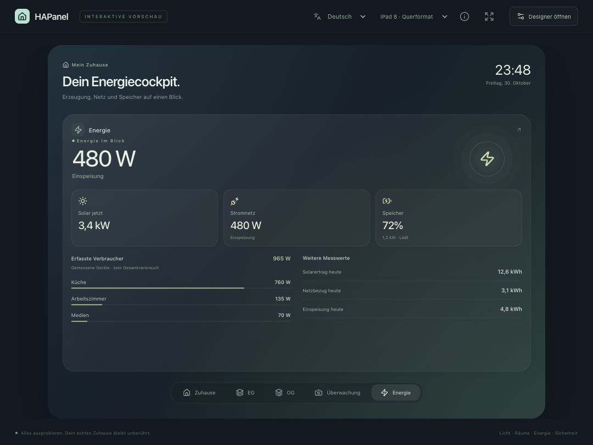
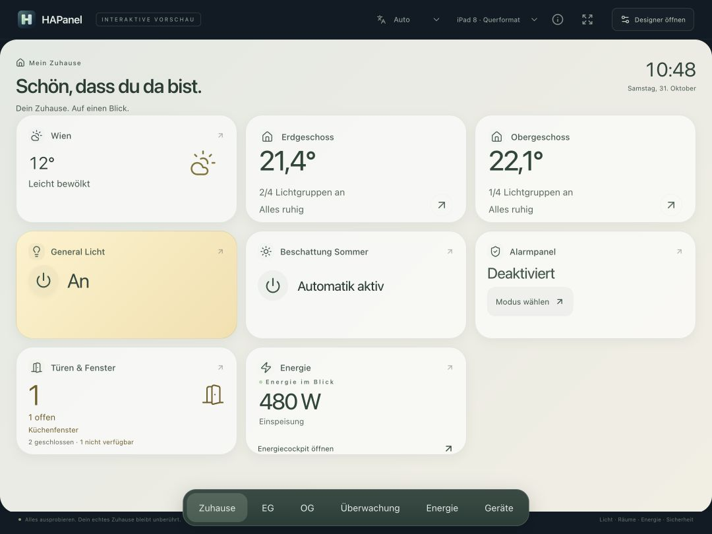
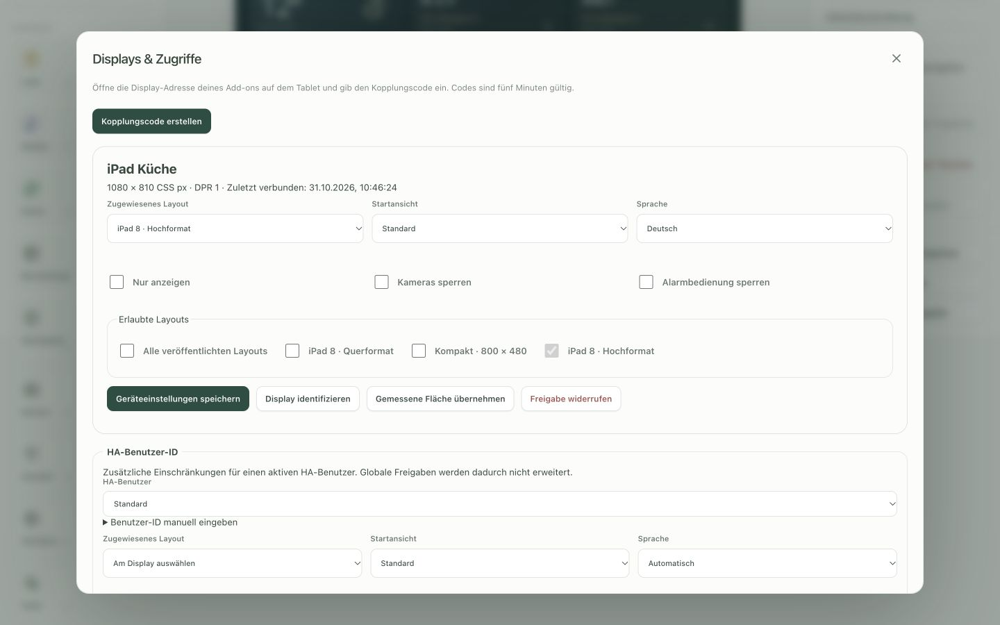
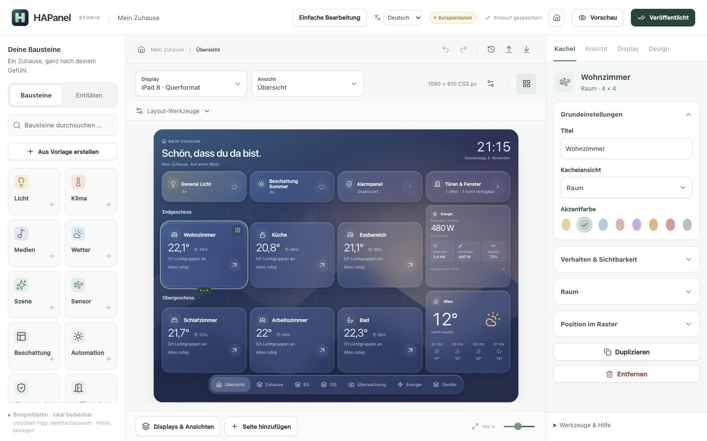
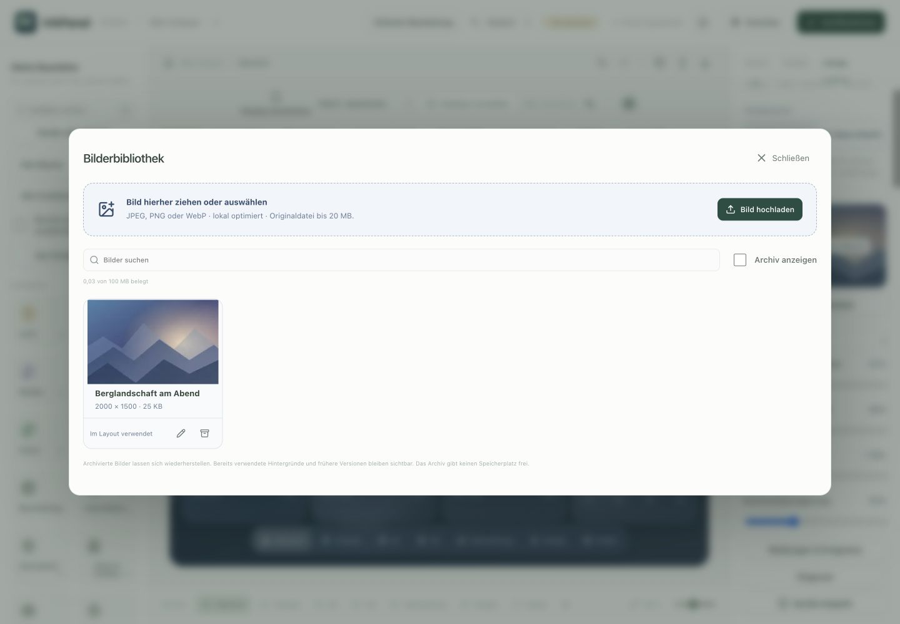
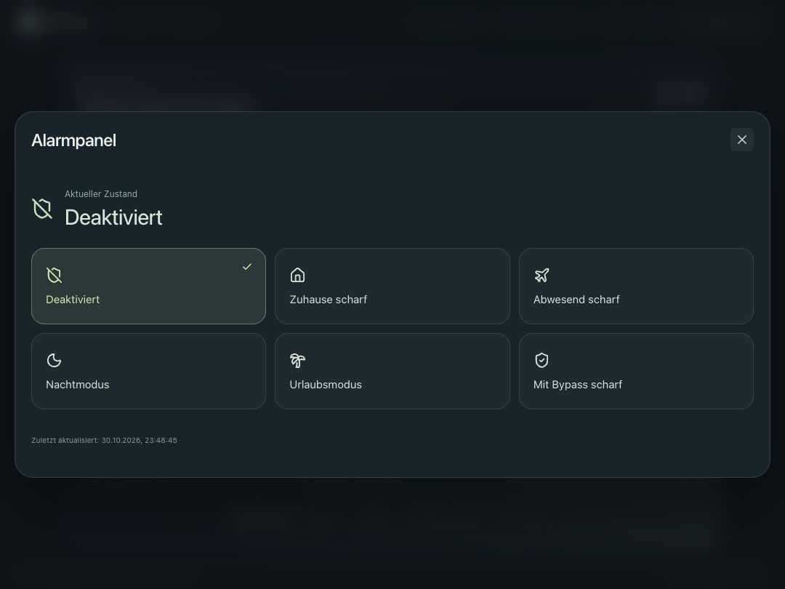
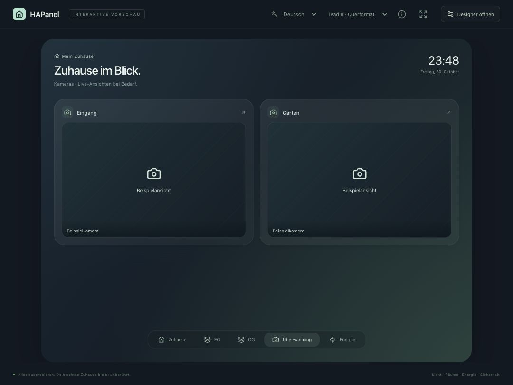
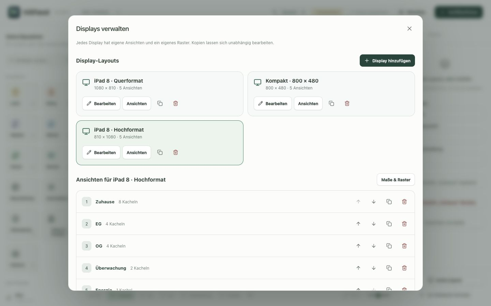
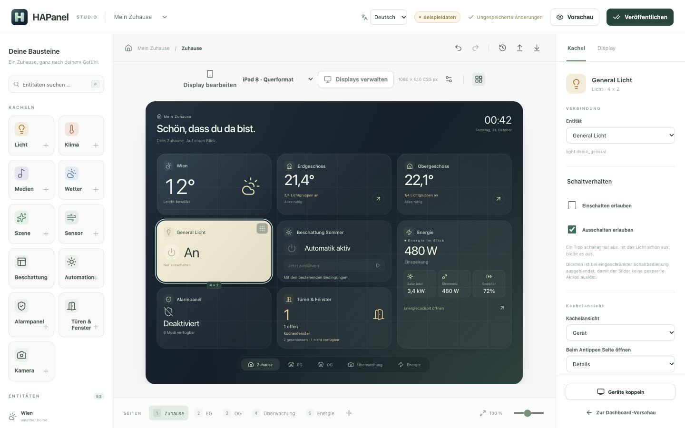
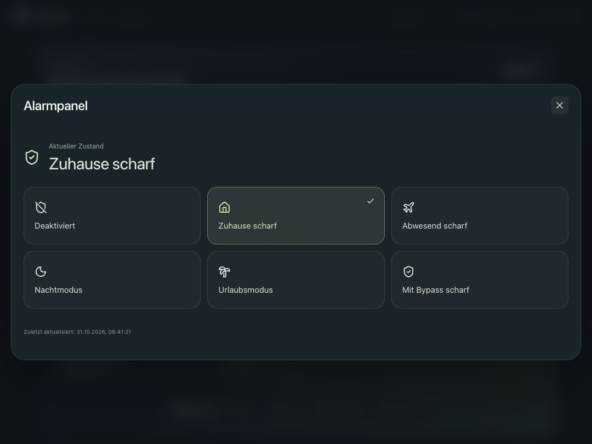

<p align="center"></p>
<h1 align="center">HAPanel</h1>
<p align="center">Dein Zuhause. Auf einen Blick.</p>
<p align="center">Ein eigenständiges Home Assistant Dashboard mit visuellem Editor – für dein Wandtablet und browserfähige Touchdisplays.</p>
<p align="center"><a href="https://cococheaf.github.io/HAPanel/">Interaktive iPad-Vorschau</a> · <a href="DOCS.md">Installation</a> · <a href="docs/architecture.md">Architektur</a> · <a href="CONTRIBUTING.md">Mitmachen</a></p>

**Deutsch · [English](README.en.md)**

**Ein Vibe-Coding-Projekt:** HAPanel entsteht mit KI-Unterstützung. Der Projektinitiator bringt Idee, Gestaltung und Praxistests ein und hat selbst keine Programmiererfahrung. Code-Reviews, verständliche Fehlermeldungen und Beiträge aus der Community sind ausdrücklich willkommen.


<details><summary>Visuellen Editor ansehen</summary>


</details>

<details><summary>Energiecockpit ansehen</summary>



</details>

HAPanel verbindet großzügige, abgerundete Kacheln, ruhige Farben und direkte Touch-Bedienung mit einem visuellen Layout-Editor. Es läuft als eigene Home Assistant App (Add-on) oder als lokaler Node.js-Prozess. Bestehende Lovelace-Dashboards und HA-Konfigurationsdateien bleiben unverändert.

**Version: 2.3.0.** Die Vorschau, der Editor und die API sind implementiert. Die HA-Anbindung ist gegen einen simulierten WebSocket-Server geprüft. Installation, Update, Ingress und Live-Daten sind auf HA OS 18.4 / Core 2026.10.4 (amd64) geprüft. Tests auf physischer iPad-Hardware stehen noch aus.





## Neu in 2.3

Der Designer ist neu geordnet: getrennte Bibliotheksbereiche für Bausteine und Entitäten, durchsuchbare Auswahlfelder mit Raum-/Geräteinformationen, ein eigener Ansichtsreiter und aufklappbare Eigenschaften. Layout-Werkzeuge und seltene Verwaltungsaktionen sind kompakt zusammengefasst. Kleine Bildschirme erhalten Seitenleisten mit Hintergrundfläche und größere Kopfleisten-Bedienflächen.

[Designer verwenden](docs/designer.md)



## Neu in 2.2

- Eigene Hintergrundbilder mit lokaler Optimierung, Bildausschnitt, Helligkeit, Unschärfe und Farbübernahme.
- Bilderbibliothek mit Suche, Umbenennen, Archiv und Wiederherstellung; unabhängig gestaltbare Ansichten und frei bearbeitbare Farbverläufe.
- Design-Dateien mit Bild und vollständige Projektdateien mit Layouts und zugeordneten Bildern für Sicherung und Umzug.
- Dezente Seitenübergänge und automatisches Neuladen künftiger App-Updates auf Displays ab 2.2.

[Eigene Bilder und Designs verwenden](docs/designs.md)



## Neu in 2.0

- Displayzuordnung, Bildschirmmessung, Identifikation und zusätzliche Zugriffsregeln je Gerät oder HA-Benutzer.
- Adaptive Layouts, Hell-/Dunkelmodus, Nachtzeiten, Ruheansicht, Startseite und Wisch-Navigation.
- Mehrfachauswahl, Ausrichten, Kopieren/Einfügen, Positionssperre, Vorlagen und Layoutprüfung.
- Konfigurierbare Tipp-/Halteaktionen, Sichtbarkeitsbedingungen, Icons, Farben und Zusatztexte.
- Timer, Auswahlfelder, Zahlenregler, Ventilatoren, Staubsauger, Tasten und erweiterte Licht-/Klimabedienung.
- Meldungen aus Zustandswechseln oder HA-Ereignissen, getrennte Kameravorschauquellen und ein einstellbares Streamlimit.
- Energie-Statistiken für 24 Stunden, 7 und 30 Tage; Zählerquellen und feste Tarife sind explizit konfigurierbar.

[Bedienung der neuen Funktionen](docs/experience.md) · [Widget-Modell](docs/widgets.md)

## Glass und eigene Designs

Vier frei anpassbare Vorlagen, eine Designbibliothek pro Installation und unabhängige Gestaltung pro Display: Farben, Glas, Hintergrund, Rundung und Textgröße. Designs lassen sich als reine Gestaltungsdateien teilen. Der Designer bietet frei platzierbare Abschnittsüberschriften und ein bearbeitbares Glass-Startlayout. [Anleitung für eigene Designs](docs/designs.md).

## Ausprobieren

Öffne die [Vorschau](https://cococheaf.github.io/HAPanel/) in Safari auf dem iPad. Raumdetails, Licht, Dimmer, Temperatur, Beschattung, Wetter und Energiecockpit sind mit Beispieldaten bedienbar. Über **Designer öffnen** kannst du das Layout bearbeiten. Änderungen bleiben in deinem Browser; **Veröffentlichen** übernimmt den Entwurf in die Vorschau-Ansicht.

Für eine eigenständige Ansicht: **Teilen → Zum Home-Bildschirm**. Wähle bei Bedarf das Querformat- oder Hochformatprofil. Die öffentliche Vorschau hat keine Verbindung zu einem echten Home Assistant und enthält keine Zugangsdaten. Mediensteuerung simuliert Zustände; die Vorschau spielt kein Audio ab.

## Bereits enthalten

- General-Lichtgruppen, Automationen, direkte Alarmbedienung mit konfigurierbaren Modi sowie eine filterbare Übersicht offener Türen und Fenster.
- Kamerakacheln mit Vorschaubildern, optionaler Live-Übersicht, WebRTC und HLS; Bildfolge für Kameras ohne Stream-Unterstützung.
- Raumübersicht mit getrennten Etagen, antippbaren Details und eigener Geräteansicht pro Raum.
- Licht, Klima, Beschattung, Medien mit Album-Art, Wetter mit Stundenprognose, Szenen und Sensoren.
- Energiecockpit für Solar, Netz, Speicher und erfasste Verbraucher; Messwerte mit 24-Stunden-Verlauf.
- Deutsche und englische Oberfläche mit automatischer Browser-Spracherkennung und manueller Sprachwahl; weitere Sprachen sind über zentrale Übersetzungsdateien ergänzbar.
- Visueller Editor mit Verschieben, Größenänderung, numerischen Positionen und Undo/Redo.
- Mehrere Seiten und Displayprofile; Beispielprofile für iPad 8 in beiden Ausrichtungen und 800 × 480.
- Getrennte Hardwareauflösung und Browserfläche, einstellbares Raster, Außenränder und Abstände.
- Exakte Darstellung oder proportionales Einpassen; identische Kacheln in Editor und Player.
- Automatisch gespeicherte Entwürfe, explizite Veröffentlichung und bis zu 30 ältere Revisionen.
- JSON/YAML-Import und Export.
- Serververbindung zu HA mit gefilterten Entitätsabonnements, Wiederverbindung und serverseitigen Aktionen.
- Administratorzugang für den Designer, optionaler Kamera-Lesezugang für aktive HA-Benutzer und widerrufbar gekoppelte Displays.
- Dockerfile und GitHub Actions für Validierung, statische Vorschau und Container-Builds auf amd64/aarch64.

## Lokal entwickeln

Node.js 24 LTS empfohlen; Mindestversion 22.12.

```sh
npm ci
npm run dev
```

- Studio: <http://127.0.0.1:5173/>
- Eigenständige Browservorschau: <http://127.0.0.1:5173/preview.html>
- API: <http://127.0.0.1:4310/api/health>

Der Standardmodus verwendet ausschließlich Beispieldaten. Serverseitige Layouts liegen im ignorierten Verzeichnis `.data/`. Die eigenständige Browservorschau speichert ihre Layouts dagegen im Browser.

```sh
npm test
npm run build
npm run build:preview
npm start
```

Nach dem Produktionsbuild liefert `npm start` Studio und Player über Port 4310 aus. Die weiteren Betriebsarten, Kopplung und Reverse-Proxy-Einstellungen stehen in [DOCS.md](DOCS.md).

## Isolation und Zugriff

HAPanel benötigt keinen Mount der HA-Konfiguration, keine Custom Cards, keine zusätzliche HA-Integration und keine Hardwarefreigaben. Eigene Daten liegen im privaten Add-on-Speicher. Reguläre Bedienaktionen verändern selbstverständlich den gemeinsamen HA-Gerätezustand.

Das Supervisor-Token bleibt im Backend und wird als Administratorzugang behandelt. Displays übergeben Kachel-IDs und erlaubte Bedienbefehle; HA-Services und Zielentitäten werden vom Server aus der veröffentlichten Konfiguration bestimmt. Kopplungscodes sind fünf Minuten gültig und einmal verwendbar; Gerätesitzungen sind widerrufbar und laufen nach 90 Tagen ab. Für den echten Displaybetrieb ist ein HTTPS-Endpunkt mit korrekt gesetztem `public_origin` vorgesehen.

## Nächste Schritte

Die [Roadmap](docs/roadmap.md) benennt die noch offenen Arbeiten: physische iPad- und Langzeitabnahme, automatische Viewport-Kalibrierung, weitere Gerätefähigkeiten und vollständig adaptive Layouts. Deutsch und Englisch sind von Anfang an unterstützt; [weitere Sprachen](docs/translations.md) können folgen. Unbekannte Schemaversionen werden ausdrücklich abgelehnt und ihre Dateien erhalten. Geteilte Ansichten in Schema 1 werden mit einer Sicherung der Originaldatei in unabhängige Display-Ansichten überführt.

## Herkunft und Lizenz

Die Kachelidee und der visuelle Arbeitsablauf sind von [Tessera](https://github.com/MaxGramser/homeassistant_espscreen) inspiriert. HAPanel ist eine eigenständige Implementierung; Tessera-Code, Firmware und Assets wurden nicht übernommen. HAPanel enthält keine ESPHome-, Flashing-, USB- oder Mikrocontroller-Logik.

HAPanel: [MIT](LICENSE). Icons: [Lucide](https://lucide.dev/license). Beispiel-Albumcover und Projektlogo sind eigene SVG-Grafiken. Die gesamte Darstellung wird lokal erzeugt; es gibt keine externen Fonts, Analyse-Skripte oder Bilddienste. HAPanel ist ein unabhängiges Projekt und kein Produkt von Apple oder dem Home-Assistant-Projekt.

<details><summary>Alarm direkt bedienen · Überwachung</summary>





</details>

## Displays und Kameras

Im Designer befindet sich oben **Display bearbeiten** mit der Display-Auswahl. **Displays verwalten** öffnet die gemeinsame Übersicht für neue Layouts, Kopien und Löschaktionen. Dort lassen sich Ansichten auch mit gefüllten Kacheln löschen, sortieren oder auf ein anderes beziehungsweise neues Display kopieren. Kopien sind unabhängig. Farben und Begrüßung gelten für das ausgewählte Display. **Geräte verwalten** kümmert sich separat um gekoppelte Browserzugänge.

In einer Kamerakachel unter **Kameraübersicht** zwischen **Standbild** und **Livestream** wählen. **Automatisch** bevorzugt die von HA angebotene WebRTC-Verbindung und fällt bei Bedarf auf HLS zurück. WebRTC benötigt eine erreichbare direkte Medienverbindung im Netzwerk; HLS kann weiterhin verzögert sein. Im HLS-Detail hilft **Zur Livekante springen**.



## Licht einfach und passend bedienen

Im Designer eine Lichtkachel auswählen → **Schaltverhalten**. Die Checkboxen **Einschalten erlauben** und **Ausschalten erlauben** bestimmen die Schaltfläche:

| Einschalten | Ausschalten | Verhalten                     |
| ----------- | ----------- | ----------------------------- |
| ✓           | ✓           | Zwischen Ein und Aus wechseln |
| ✓           | —           | Nur einschalten               |
| —           | ✓           | Nur ausschalten               |
| —           | —           | Nur Zustand anzeigen          |

Das gilt auch für Schalter wie General Licht und für Geräte innerhalb einer Raumkachel. Die Regeln werden im Backend geprüft. Sie beschränken die jeweilige HAPanel-Kachel; andere HA-Bedienelemente und Automationen bleiben davon unabhängig.

Ein Dimmer erscheint nur bei bestätigter Dimmfähigkeit. Bei Gruppen müssen **alle** Mitglieder dimmbar sein; normale Lampen, Schalter, gemischte oder nicht vollständig bekannte Gruppen erhalten keinen Slider. Die Helligkeit eines eingeschalteten Lichts wird bei fehlendem Messwert als unbekannt angezeigt. Bei einseitiger Schaltbedienung bleibt der Slider ausgeblendet. Für dimmbare Kacheln lässt er sich zusätzlich über **Dimmerslider anzeigen** ausblenden.

Seitennamen, Seitenüberschriften und eigene Beschriftungen behalten Leerzeichen beim Tippen und Speichern. Pflichtfelder lassen sich zum Umbenennen vorübergehend leeren; beim Verlassen eines noch leeren Feldes wird der letzte gültige Text wiederhergestellt.



## Kameras ohne Administratorrolle

Unter **Einstellungen → Apps → HAPanel → Konfiguration → Kameraanzeige** die Option `authenticated` wählen, speichern und neu starten. Der Standard `admin` erhält die bisherige Freigabe.

Mit `authenticated` sehen **aktive, angemeldete HA-Benutzer** die veröffentlichte HAPanel-Ansicht einschließlich Kameras als **Nur Anzeige**. **Gültig gekoppelte Tablets** erhalten ebenfalls Kamerabilder und behalten ihre bisherigen Bedienrechte. Designer, Entwürfe und Kopplungsverwaltung bleiben Administratoren vorbehalten. Alarmbefehle können getrennt über `alarm_access` freigegeben werden. Ohne HA-Anmeldung oder gültige Kopplung gibt es keinen Kamerazugriff.

Die Freigabe gilt für alle Kameras in der veröffentlichten HAPanel-Konfiguration, nicht für beliebige HA-Entitäten. Sie ist eine eigene HAPanel-Freigabe und keine Übernahme individueller HA-Entitätsberechtigungen.

## Alarmpanel ohne Administratorrolle

Unter **Einstellungen → Apps → HAPanel → Konfiguration → Alarmbedienung** `authenticated` wählen, speichern und neu starten. Damit dürfen aktive HA-Benutzer und gültig gekoppelte Tablets die veröffentlichten Alarmmodi direkt in HAPanel bedienen. Kameraanzeige und Alarmbedienung werden unabhängig freigegeben; beide stehen standardmäßig auf `admin`.

Ob eine PIN nötig ist, bestimmt die HA-Alarm-Entität. HAPanel übernimmt diese Vorgabe und verlangt weiterhin die Bestätigung des gewählten Modus. Wiederholte Versuche sind begrenzt; Alarmcodes werden nicht gespeichert. Der Designer und die Geräteverwaltung bleiben geschützt. Andere Geräteaktionen bleiben für normale HA-Betrachter gesperrt; gekoppelte Tablets behalten ihre bisherigen Bedienrechte.


