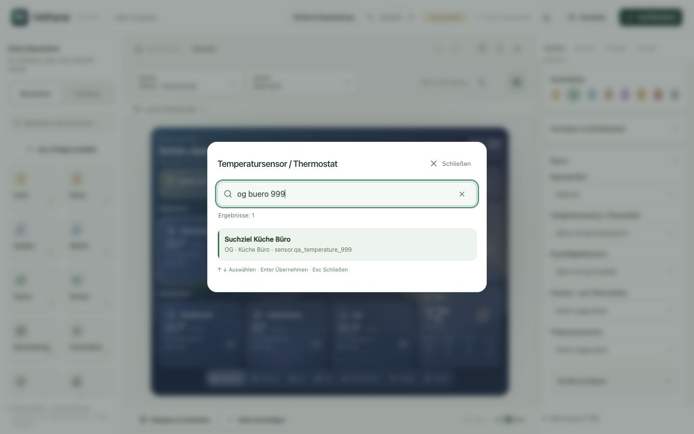

# Designer / Designer

## Deutsch

Der Designer besteht aus drei Arbeitsbereichen: Bibliothek, Vorschau und Eigenschaften. Änderungen werden als Entwurf gespeichert. Erst **Veröffentlichen** übernimmt sie auf die Displays.

### Bausteine und Entitäten

Links wählst du zwischen **Bausteine** und **Entitäten**. Bausteine sind die Kartentypen; Entitäten sind deine Geräte und Sensoren aus Home Assistant. Beide Bereiche haben eine eigene Suche. Bei Entitäten kannst du zusätzlich nach Raum und Funktion filtern oder bereits platzierte Geräte ausblenden. Geräte innerhalb von Raumkarten werden dabei berücksichtigt.

Die Suche findet Namen, technische IDs, Räume, Geschosse und Gerätenamen. Mehrere Wörter grenzen die Auswahl gemeinsam ein. Umlaute, Schreibweisen wie `ue` und `ß`/`ss` werden vereinheitlicht. Mit **Filter zurücksetzen** kommst du zur gesamten Liste zurück. Große Listen zeigen zunächst 100 Einträge; **Weitere anzeigen** erweitert sie. Die Suche berücksichtigt immer den gesamten Katalog.

### Display und Ansicht auswählen

Über der Vorschau stehen die Auswahlfelder **Display** und **Ansicht**. Über **Displays & Ansichten** unten erreichst du die Verwaltung zum Kopieren, Erstellen, Entfernen und Ordnen. Die vier Reiter rechts haben jeweils eine klare Aufgabe:

- **Kachel:** Verbindung, Grundeinstellungen, typabhängige Optionen, Verhalten und Position der gewählten Karte.
- **Ansicht:** Name, Überschrift, Beschreibung und Navigation der aktuellen Ansicht – unabhängig von der gewählten Kachel.
- **Display:** Displayprofil, Browserfläche, Raster, Abstände und Darstellungsverhalten.
- **Design:** Hintergrundbilder, Vorlagen, eigene Gestaltung und gespeicherte Designs für das Display oder die aktuelle Ansicht.

Verwandte Einstellungen liegen in aufklappbaren Abschnitten. Unter **Werkzeuge & Hilfe** findest du Hilfe, Meldungen, Diagnose und die Geräte-/Zugriffsverwaltung. Die **Layout-Werkzeuge** über der Vorschau enthalten Kopieren, Einfügen, Ausrichten, Abstände und Layoutprüfung. Werkzeuge für mehrere Kacheln werden erst bei einer passenden Auswahl aktiv.

### Durchsuchbare Auswahlfelder

Die Auswahlfelder im Designer öffnen eine Suchauswahl. Bei Entitäten stehen Raum, Geschoss, Gerät und Entitäts-ID unter dem Namen, soweit Home Assistant diese Angaben liefert. Die aktuelle Auswahl ist markiert. Nicht verfügbare Werte können weiterhin angezeigt, aber nicht neu gewählt werden.

Tippen oder klicken übernimmt eine Option. Mit **↑/↓** navigierst du, mit **Enter** übernimmst du und mit **Escape** oder **Schließen** brichst du ab. Abbrechen verändert den bisherigen Wert nicht. In verschachtelten Dialogen bleibt die darunterliegende Bearbeitung offen. Große Auswahlen rendern zunächst 80 Treffer; die Suche umfasst weiterhin alle Optionen.

Die allgemeine Sprachauswahl in der Kopfleiste verwendet weiterhin die kleine native Browserauswahl mit Auto, Deutsch und Englisch.

### Kleine Bildschirme und Tastatur

Auf Tablet- und Handybreite öffnen sich Bibliothek bzw. Eigenschaften bei Bedarf als Seitenleiste. Ein Tipp auf den abgedunkelten Bereich oder die Schließen-Fläche schließt sie. Versteckte Seitenleisten sind nicht per Tastatur erreichbar. Die Suchauswahl liegt über der Oberfläche und wird nicht von einer Seitenleiste abgeschnitten.

Kacheln lassen sich mit ihren Griffen verschieben und an der Ecke skalieren. **Umschalt-Tipp** markiert mehrere Karten. **⌘/Strg Z** macht Änderungen rückgängig, **⌘/Strg C/V** kopiert bzw. fügt Kacheln ein und die Pfeiltasten verschieben die Auswahl auf dem Raster. **⌘/Strg K** öffnet die Entitätensuche. In Eingabefeldern und Dialogen bleiben die üblichen Text- und Auswahlfunktionen aktiv.

## English

The designer separates the library, preview and properties. Changes are saved as a draft; **Publish** sends them to displays.

- Choose **Building blocks** or **Entities** on the left. Search names, IDs, rooms, floors and devices; combine room/kind filters with **Hide placed entities**. Devices inside room cards count as placed. **Reset filters** restores the full list. Large libraries initially show 100 entries, while search always covers the full catalog.
- Choose the target **Display** and **View** above the preview. **Displays & views** opens layout/view management. The right-hand **Tile**, **View**, **Display** and **Design** tabs have separate responsibilities. A view can be edited without deselecting its tiles.
- Related properties are grouped into expandable sections. Less frequently used actions live under **Tools & help**; alignment and copy/paste live under **Layout tools**.
- Designer selection fields open a searchable picker. Entity options include room/floor/device metadata and their ID when available. Use arrow keys, Enter or click/tap to choose; Escape or Close cancels without changing the value. Closing an inner picker keeps the parent dialog open. A result page contains up to 80 options; all options remain searchable.
- On smaller screens, sidebars open when needed and close through their close button or the dimmed background. Hidden sidebars cannot receive keyboard focus. The mobile footer still shows draft/save status.
- Shift-tap selects multiple tiles. ⌘/Ctrl Z undoes; ⌘/Ctrl C/V copies/pastes tiles; arrows move selected tiles. ⌘/Ctrl K opens entity search. Standard text editing stays active in inputs and dialogs.

The three-choice language control in the header remains a native browser select. Physical iPad/touch-hardware testing remains pending; responsive browser testing is documented in [validation.md](validation.md).
