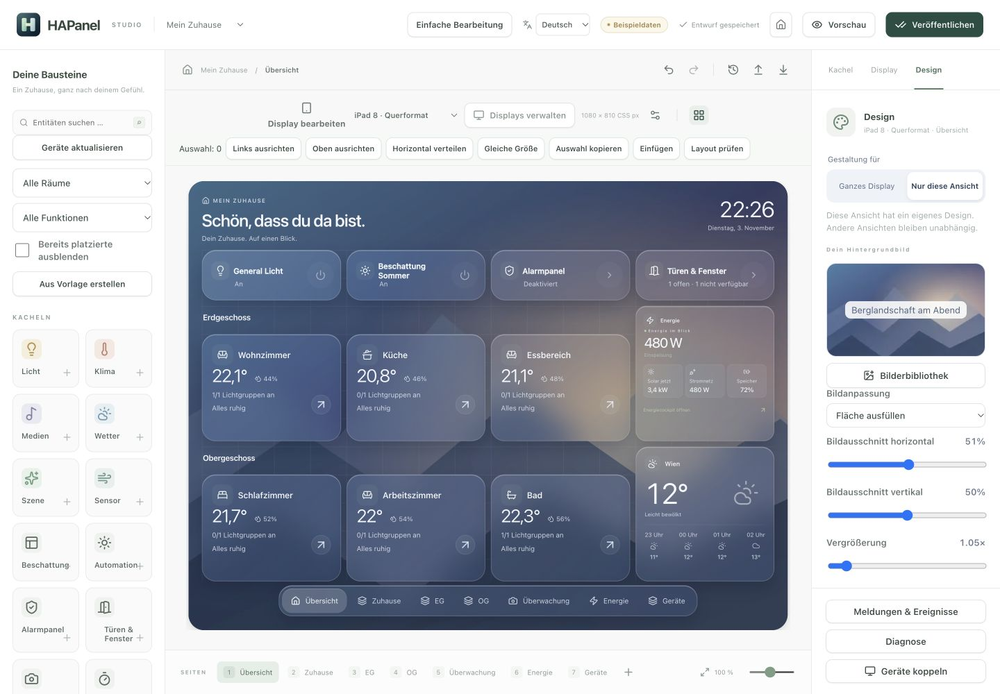

# Eigene Designs und Hintergrundbilder / Custom designs and wallpapers

**Deutsch · English below**

HAPanel 2.2 verbindet frei bearbeitbare Layouts mit einer lokalen Bilderbibliothek. **Glass Dunkel, Glass Hell, Aurora und Minimal** dienen als Ausgangspunkte.

## Ein Bild einsetzen

1. In der HA-App **Designer öffnen**, das **Display** und die gewünschte Ansicht auswählen.
2. Rechts **Design** öffnen. **Ganzes Display** gestaltet alle erbenden Ansichten; **Nur diese Ansicht** erstellt eine unabhängige Gestaltung für die aktuelle Seite. **Displaydesign übernehmen** stellt die Vererbung wieder her.
3. Unter **Dein Hintergrundbild → Bilderbibliothek** ein Bild hochladen oder in die Uploadfläche ziehen. Unterstützt werden einzelne JPEG-, PNG- und WebP-Bilder bis 20 MB und 36 Megapixel. Größere Originale vorher verkleinern.
4. **Fläche ausfüllen** oder **Ganzes Bild zeigen** wählen. Horizontaler/vertikaler Fokus und Vergrößerung bestimmen den Bildausschnitt. Helligkeit, Hintergrundunschärfe und Kontrastüberlagerung sorgen für Lesbarkeit. Im hellen Design hellt die Überlagerung auf, im dunklen dunkelt sie ab.
5. Mit **Farben aus Bild** eine passende Ausgangspalette übernehmen oder Farben frei wählen. Beim Vorlagenwechsel kann das eigene Bild beibehalten werden. **Bild aus diesem Design entfernen** erhält die übrige Gestaltung; die Datei bleibt in der Bibliothek.
6. Erst **Veröffentlichen** aktualisiert die verbundenen Displays.

Uploads werden im Browser verkleinert und auf dem HAPanel-Backend als WebP mit höchstens 2560 Pixeln Kantenlänge und 2 MB pro Bild normalisiert. EXIF-/Kamerametadaten werden entfernt. Vorschaubilder und identische Inhalte werden wiederverwendet. Dateien liegen im persistenten HAPanel-Datenverzeichnis, nicht in HA-Lovelace oder im GitHub-Repository. In der öffentlichen Browser-Vorschau liegen eigene Bilder ausschließlich im IndexedDB-Speicher dieses Browsers.

Die Bibliothek bietet Suche, Umbenennen, Archivieren und Wiederherstellen. Archivieren verändert bereits zugeordnete Bilder und frühere Revisionen nicht und gibt keinen Speicherplatz frei. Die gesamte Bibliothek ist auf 100 MB und 200 Bilder begrenzt, einschließlich Archiv. Endgültiges Löschen ist in dieser Version nicht vorgesehen.

## Gestaltung und Vorlagen

Pro Display oder Ansicht lassen sich Kachelstil, Tag-/Nachtmodus, Farben, Glas, Schatten, Rundung und Beschriftung anpassen. Der Verlaufseditor bietet zwei Farben, Richtung und lineare/radiale Verläufe. **Sanft einblenden** aktiviert dezente Seitenwechsel; reduzierte Bewegung wird berücksichtigt.

Unter **Meine Designs** eigene Vorlagen benennen und speichern. Anwenden erstellt eine unabhängige Kopie. Änderungen, Vererbung und das Entfernen gespeicherter Vorlagen unterstützen Rückgängig. Bis zu 24 Vorlagen sind möglich.

**Exportieren / Importieren** überträgt ein Design samt verwendetem Hintergrundbild in einer Datei bis 3 MB. Dabei werden Gestaltung, Bild und der selbst gewählte Name übertragen, keine HA-Entitätsbindungen, Kameraadressen oder Zugangsdaten. Ältere Design-Dateien ohne Bilder bleiben importierbar. Skripte, externe Bild-URLs und freies CSS werden nicht akzeptiert.

## Ein vollständiges Projekt übertragen

**Konfiguration exportieren → Komplettes Projekt mit Bildern sichern** erstellt eine `.hapanel`-Datei mit dem aktuellen Entwurf, Displayprofilen, Ansichten, Kacheln, Entitätsbindungen, Designvorlagen und ihren zugeordneten Bildern. Mehrfach verwendete Bilder sind nur einmal enthalten.

Auf der Zielinstallation **Konfiguration importieren → Datei auswählen** wählen. Die Zusammenfassung zeigt Displays, Ansichten und Bilder. **Als Entwurf importieren** lädt Bilder in die lokale Bibliothek und übernimmt die Konfiguration als neue Revision. Die bisherige Veröffentlichung bleibt bis zum erneuten Veröffentlichen aktiv. Entitätsbindungen müssen auf der Zielinstallation vorhanden sein; die Layoutprüfung zeigt fehlende Quellen.

Projektdateien sind auf 32 MB begrenzt. Die Versionshistorie, nicht zugeordnete Bibliotheksbilder, App-Optionen und Gerätekopplungen sind nicht Teil der Projektdatei. Ein vollständiges HA-App-Backup enthält auch das persistente Bildverzeichnis und ist die Sicherung für diese zusätzlichen Daten oder größere Projekte. Reines JSON/YAML enthält weiterhin ausschließlich die Konfiguration und Bildreferenzen; für die Übertragung mit Bildern die Projektdatei verwenden.

## Layout und Betrieb

**Glass-Übersicht hinzufügen** erstellt aus vorhandenen Kacheln eine zusätzliche frei bearbeitbare Startseite mit Schnellzugriffen, Raumgruppen, Energie und Wetter. Es passt nur das Raster des ausgewählten Displays an und erhält bestehende Ansichten und Geräte.

**Abschnitt / Überschrift** ist frei platzierbar und kann auf eine andere Ansicht verweisen. Licht-, Automations-, Alarm- und Kontaktkacheln bieten **Kompakter Schnellzugriff**. Details bleiben vollständig erreichbar. Weniger Unschärfe oder **Deckend** helfen bei schwächeren Displays.

Normale Displays enthalten keine Einrichtungsflächen. Ab 2.2 erkennen sie künftige App-Versionswechsel und laden die Programmdateien automatisch neu. Ein offenes Detailfenster verzögert das Neuladen bis zum Schließen. Nach dem ersten Update von 2.1 auf 2.2 ist einmaliges manuelles Neuladen erforderlich. Der Designer lädt ungespeicherte Bearbeitungen nicht automatisch neu.

Konfigurationen mit Bildern oder Ansichtsdesigns benötigen HAPanel 2.2+. Für ein Downgrade die vor dem Update gesicherte Konfiguration verwenden. Physische iPad-Touch- und Langzeitprüfungen bleiben separat durchzuführen.

---

## English

Open the HA app’s **Designer**, select the target **Display** and view, then open **Design**. Choose **Whole display** or **This view only**. Views inherit the display appearance until customized; **Inherit display appearance** restores inheritance.

Under **Your background image → Image library**, upload or drop a JPEG, PNG or WebP image up to 20 MB and 36 megapixels. Choose fill/contain, focus, zoom, brightness, blur and contrast overlay. Dark appearance uses a black overlay; light appearance uses white. **Colors from image** provides a starting palette. Presets can retain your wallpaper. Removing an image from a design keeps its file in the library. Publish when ready.

Images are downscaled locally and normalized by HAPanel to WebP, at most 2560 pixels on either edge and 2 MB. Camera/EXIF metadata is removed. Thumbnails and identical files are reused. Production images stay in HAPanel’s persistent storage. The browser-only preview stores personal pictures in this browser’s IndexedDB, without uploading them to GitHub.

Search, rename, archive and restore images. Archived pictures continue working in existing layouts and earlier revisions. Archiving does not reclaim space. The library holds up to 100 MB or 200 images including archived items; permanent removal is not available in this version.

Customize surfaces, appearance, colors, glass, corners and text. Build linear/radial gradients and optionally enable gentle page transitions. Reduced motion is respected. Save up to 24 independent design presets. **Export / Import** carries a design and its active background image in a file up to 3 MB; it excludes HA entity bindings and credentials. Legacy appearance-only files remain supported.

**Export configuration → Back up complete project with images** produces a `.hapanel` file containing the current draft, displays, views, tiles, entity bindings, design presets and associated images, with each image included once. Import that file through **Import configuration → Choose file**. Its summary shows displays, views and images. Import creates a draft revision; publish separately to activate it. Entity bindings must exist on the target HA instance.

Project files are limited to 32 MB. Revision history, unassigned library pictures, app options and paired-device credentials are excluded. Use a HA app backup for those or larger projects; it includes persistent images. Plain JSON/YAML still carries configuration and image references only.

Add an editable Glass overview or freely positioned section headings; compact quick controls keep full controls in their detail sheets. Configuration stays in the administrator’s designer. Players running 2.2 detect future app version changes and reload automatically after open detail dialogs close. Reload once manually when upgrading from 2.1. The designer does not automatically reload unsaved work.

New image/view-design fields require HAPanel 2.2+. Use the pre-update configuration when downgrading. Physical iPad touch behavior and long-term performance still require separate testing.
